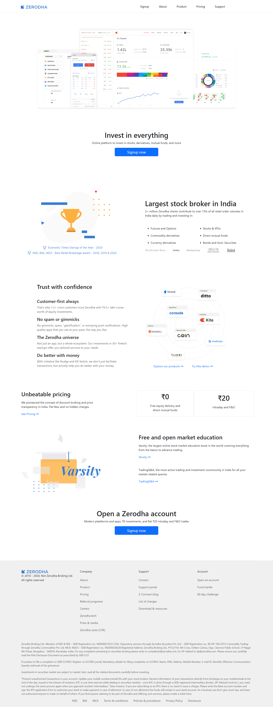

# Stock Trading Platform

A full-stack stock trading platform inspired by Zerodha.

## Tech Stack

- React.js
- Node.js
- Express.js
- MongoDB
- JavaScript
- HTML & CSS

## Project Structure

- backend – Server-side code and APIs
- dashboard – Trading dashboard
- frontend – User authentication and landing pages

## Features

- User Signup and Login
- Secure Authentication using JWT
- Stock Watchlist
- Buy Orders
- Holdings Management
- Orders and Positions

## Screenshots

### Landing Page

### Login Page

### Signup Page

### Dashboard

### Holdings

### Orders

## Installation

1. Clone the repository.
2. Install dependencies in each folder.
3. Configure environment variables.
4. Start the backend, frontend and dashboard.

## Author

Saquib Aboozar
