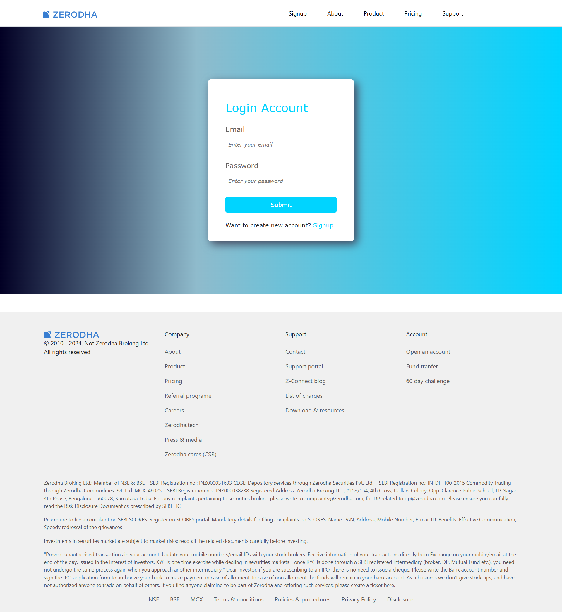
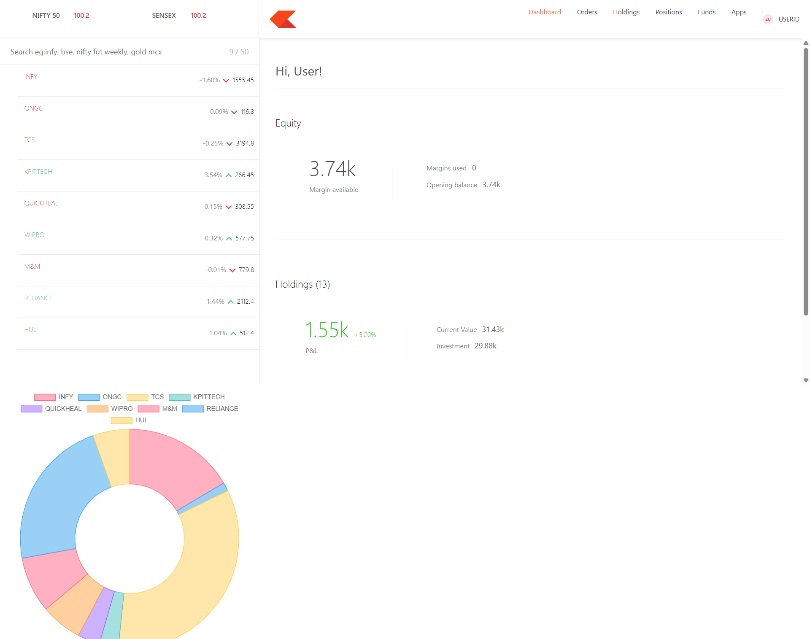
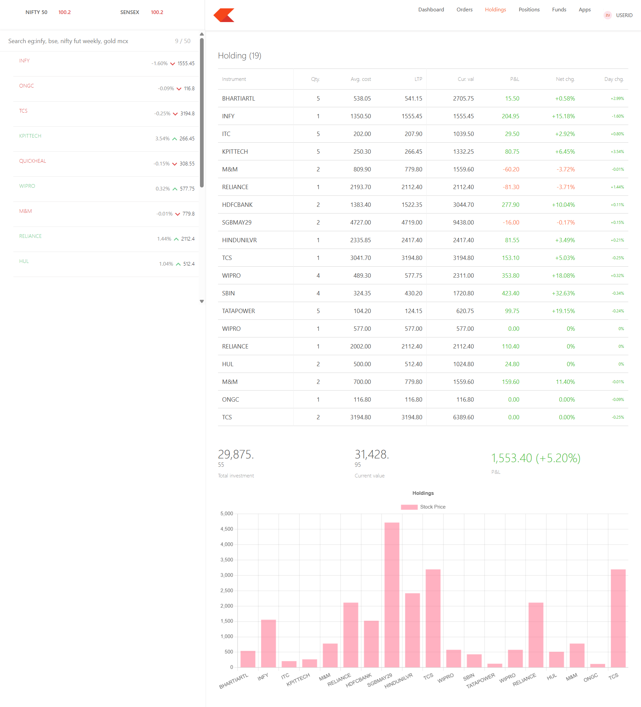
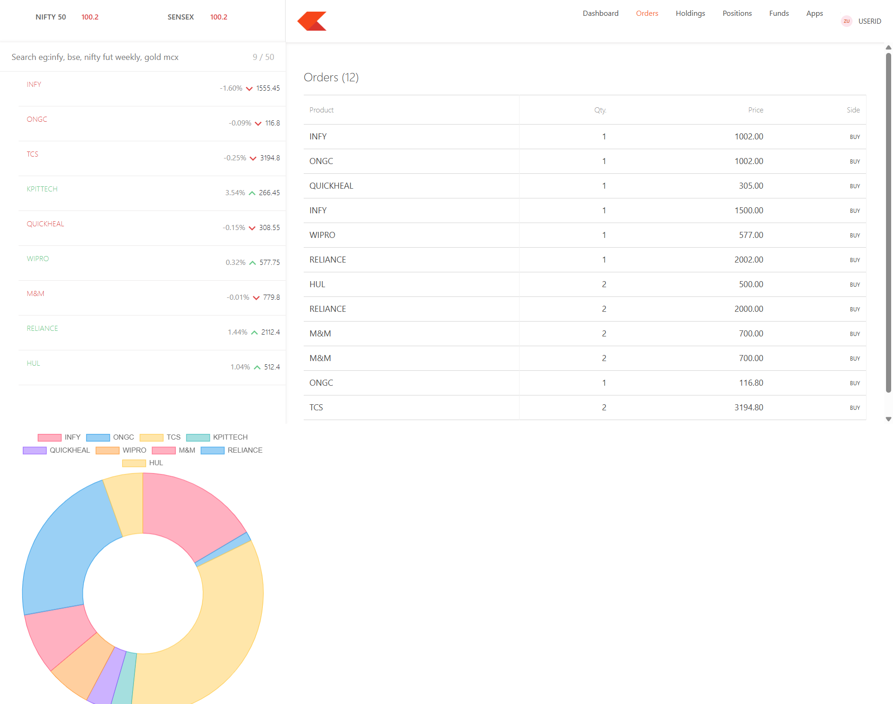

Zerodha Clone – Stock Trading Platform
A full-stack stock trading platform inspired by Zerodha, built using the MERN stack. It provides user authentication and a trading dashboard to manage watchlists, buy orders, holdings, and positions.

🚀 Live Demo
Dashboard: https://stock-trading-dashboard-app.netlify.app/
Authentication: https://stock-trading-auth.netlify.app/
Backend: https://stock-trading-backend-2sux.onrender.com/

🛠️ Tech Stack
Frontend: React.js, JavaScript, HTML, CSS
Backend: Node.js, Express.js
Database: MongoDB
Authentication: JWT, bcrypt
Deployment: Netlify (Frontend), Render (Backend)
Version Control: Git & GitHub

📁 Project Structure

Zerodha-Clone/
│
├── backend/       # Server-side code and REST APIs
├── dashboard/     # Trading dashboard application
├── frontend/      # User authentication and landing pages
│
├── screenshots/   # Project screenshots
└── README.md

✨ Features

User Signup and Login
Secure Authentication using JWT
Password Hashing using bcrypt
Stock Watchlist
Buy Orders
Holdings Management
Orders Management
Positions Management
Separate Authentication and Dashboard Applications
MongoDB Database Integration

⚙️ Installation & Setup

1. Clone the Repository

git clone https://github.com/saquibaboozar042-pixel/Stock-Trading-Platform.git
cd Stock-Trading-Platform

2. Backend Setup

cd backend
npm install

Configure your environment variables in a .env file:

MONGO_URL=your_mongodb_connection_string
TOKEN_KEY=your_jwt_secret
PORT=3002

Start the backend:

npm start

3. Frontend Setup

Open a new terminal:

cd frontend
npm install
npm start

4. Dashboard Setup

Open another terminal:

cd dashboard
npm install
npm start

## Screenshots

### Landing Page

### Login Page

### Signup Page

### Dashboard

### Holdings

### Orders

👨‍💻 Author

Saquib Aboozar

GitHub: https://github.com/saquibaboozar042-pixel

This project was built for learning and demonstrating full-stack web development concepts. It is not a real brokerage platform and does not execute actual stock trades.
